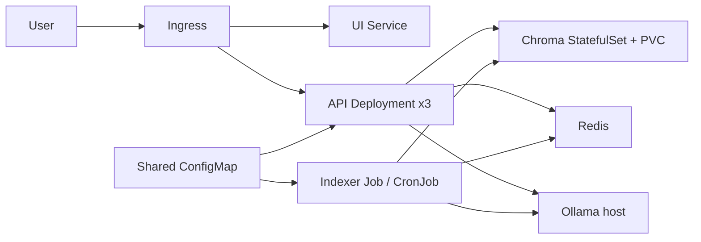

# RAHBAR: Grounded RAG on Kubernetes

[](https://github.com/NovweraAmjad/Rahbar/actions/workflows/ci.yml)
[](https://github.com/NovweraAmjad/Rahbar/actions/workflows/cd.yml)

RAHBAR answers questions about a versioned FAST-NUCES document corpus through a
grounded retrieval-augmented generation service. The indexer extracts, cleans,
chunks, embeds, and writes corpus evidence to Chroma only from a Kubernetes Job;
the API retrieves that evidence, validates structured LLM output, cites retrieved
pages, and abstains when the corpus does not support an answer. Redis is an
optional semantic answer cache. The application is deployed in the `rahbar`
namespace with probes, resource limits, HPA, persistent Chroma storage, and
default-deny network policies.

## Architecture



The API and indexer share the embedding-model pin from the ConfigMap. Chroma is
the durable vector store; the indexer is the only writer and the API is read-only.
Implementation details and limitations are in
[docs/PIPELINE.md](docs/PIPELINE.md), [docs/DEPLOYMENT.md](docs/DEPLOYMENT.md),
and [docs/CORPUS.md](docs/CORPUS.md).

## Clean-clone local path

The following is the supported local sequence from the repository root. It uses
the Makefile targets and does not require credentials for the stub development
provider:

```powershell
python -m venv .venv
.venv\Scripts\python -m pip install -r api\requirements-dev.txt -r indexer\requirements-dev.txt
python corpus\fetch.py
python corpus\fetch.py --verify
minikube start --driver=docker --cni=calico --memory=6144 --cpus=4
minikube addons enable metrics-server
minikube addons enable ingress
minikube image load rahbar-api:dev
minikube image load rahbar-indexer:dev
minikube image load rahbar-ui:dev
kubectl apply -k k8s/overlays/dev
kubectl create job --from=cronjob/reindex reindex-$(Get-Date -Format yyyyMMddHHmmss) -n rahbar
```

For a hosted provider, set `$env:LLM_API_KEY` and run `make secret` before
applying the overlay. The local stub development path does not require a key.

Build the images before loading them when starting from a clean clone:

```powershell
docker build -t rahbar-api:dev api
docker build -t rahbar-indexer:dev indexer
docker build -t rahbar-ui:dev ui
minikube image load rahbar-api:dev
minikube image load rahbar-indexer:dev
minikube image load rahbar-ui:dev
```

The exact manifest order is encoded by
[k8s/base/kustomization.yaml](k8s/base/kustomization.yaml): Namespace, ConfigMap,
Chroma, Redis, API, UI, Ingress, indexer Job, reindex CronJob, service accounts,
NetworkPolicies, and HPA. The dev and prod overlays both build this base.
For a local question, use `make ask Q="What CGPA puts a student on academic warning?"`
after obtaining the Minikube ingress address.

## API contract

| Method | Path | Purpose | Dependency behavior |
| --- | --- | --- | --- |
| GET | `/healthz` | Liveness/startup check | Does not contact Chroma, Redis, or Ollama |
| GET | `/readyz` | Readiness check | Requires Chroma, Redis, and the configured embedding model/collection |
| GET | `/metrics` | Prometheus-style request metrics | Reports request and retrieval counters |
| POST | `/api/ask` | Grounded question answering | Returns validated citations and `answered_from_context`; generation failures use the safe response path |

Example:

```powershell
make ask Q="What is the minimum CGPA required to avoid academic warning?"
```

## Evaluation and submission evidence

The committed evaluation artifacts are
[eval/results.json](eval/results.json) and [eval/baseline.json](eval/baseline.json).
The latest verified CD run is
[run 42486743569](https://github.com/NovweraAmjad/Rahbar/actions/runs/42486743569)
for commit `43923d0a75d51fe16b78836a3fb6d4662bbc72d7`; its test/evaluation,
SHA-tagged publish, deployment, indexing, and Ingress smoke-test jobs succeeded.
The requirement audit and evidence limitations are recorded in
[docs/EVIDENCE.md](docs/EVIDENCE.md).

No deployment screenshot is committed, and the Docker Hub repository URLs,
branch-protection export, and `kubectl top`/endpoint snapshots are not present
in this repository. They must be collected before submission rather than inferred
from workflow success.

## Documentation

- [Corpus and provenance](docs/CORPUS.md)
- [Indexing, retrieval, cache, and evaluation method](docs/PIPELINE.md)
- [Deployment and CI/CD](docs/DEPLOYMENT.md)
- [Evaluation report](docs/EVALUATION.md)
- [Failure analysis](docs/FAILURE-ANALYSIS.md)
- [Engineering notes](docs/ENGINEERING-NOTES.md)
- [AI-use disclosure](docs/AI-USAGE.md)
- [Architecture decision records](docs/adr/)
